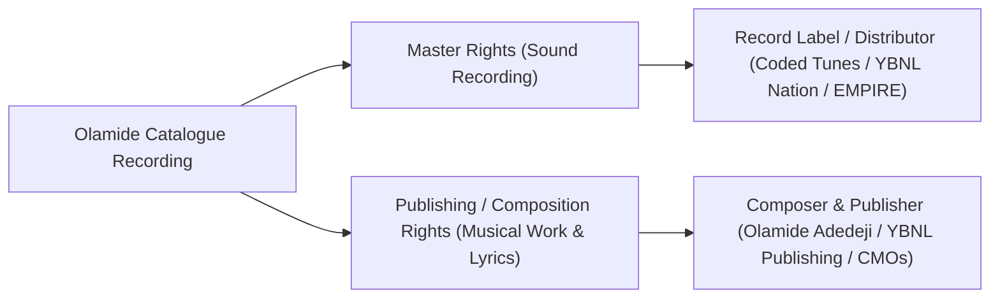

# JUSTBADDO — LICENSING AND RIGHTS CLEARANCE CHECKLIST

## 1. Legal Principle & Framework

JustBaddo operates under strict copyright compliance standards. Access to an audio file, embed API, streaming URL, or external service does not grant redistribution rights.

Every recording in the JustBaddo catalogue must satisfy explicit clearance criteria before public streaming can be authorized.

---

## 2. Dual Rights Clearance Architecture

Music licensing requires clearance across two distinct intellectual property bundles:

1. **Master Recording Rights:** The property of the entity that funded and created the physical or digital recording (e.g. Coded Tunes for *Rapsodi*, YBNL Nation for *BGEL* to *Lagos Nawa*, and EMPIRE for *Carpe Diem*, *UY Scuti*, *Unruly*, and *Ikigai*).
2. **Composition & Publishing Rights:** The underlying lyrics, melody, and musical composition written by Olamide and contributing songwriters, administered through collective management organizations (CMOs) like COSON or MCSN in Nigeria, and global publishers.

---

## 3. Label & Era Boundaries Reference Table

| Era | Primary Catalogue | Master Rights Holder | Primary Distributor | Clearance Contact Channel |
|---|---|---|---|---|
| **Early Era (2010–2011)** | *Rapsodi* (*Eni Duro*, *Omo Toh Shan*) | Coded Tunes Entertainment / ID Cabasa | Coded Tunes | Direct outreach to ID Cabasa management |
| **Independent Golden Era (2012–2019)** | *YBNL*, *BGEL*, *Street OT*, *Eyan Mayweather*, *The Glory*, *Lagos Nawa* | YBNL Nation | YBNL Nation / Independent | YBNL Nation legal counsel / Artist Management |
| **Global Expansion Era (2020–Present)** | *Carpe Diem*, *UY Scuti*, *Unruly*, *Ikigai Vol. 1* | YBNL Nation / EMPIRE Distribution | EMPIRE | EMPIRE Legal & Business Affairs (San Francisco & Lagos) |

---

## 4. Pre-Flight Licensing Verification Checklist

| Checkpoint | Requirement | Verification Standard | System Enforcement |
|---|---|---|---|
| **1. Master Permission** | Formal written license or approved platform embed terms | Contract agreement or partner developer agreement | `RightsRecord.master_rights_cleared` |
| **2. Publishing Clearance** | Mechanical and synchronization clearance for underlying lyrics | CMO agreement or direct publisher waiver | `RightsRecord.composition_rights_cleared` |
| **3. Territory Mapping** | Geographic scope verified (Nigeria, ECOWAS, Global) | Explicit country code list in license contract | `RightsRecord.territories_allowed` vs Client IP |
| **4. Term Validity** | Active effective dates verified | Start date passed, expiration date not reached | `RightsRecord.valid_from` & `valid_until` |
| **5. Tier Privileges** | Allowed usage tiers mapped | Free ad-supported vs Premium subscriber access | `RightsRecord.free_tier_permitted` & `premium_tier_permitted` |
| **6. Provider Authorization** | Approved playback transport channel | SoundCloud widget, YouTube embed, or self-hosted CDN | `RightsRecord.allowed_playback_modes` |
| **7. Immediate Takedown** | Mechanism to withdraw track within 60 seconds | Status toggled to `WITHDRAWN` | Immediate session blockage via `LicensingService` |

---

## 5. Rightsholder Notice & Takedown Desk

If a rightsholder, label representative, or copyright administrator requests the withdrawal or correction of any catalogue entry:
1. Inquiries are received via `POST /api/v1/licensing/inquiry/` (`inquiry_type: TAKEDOWN_REQUEST`).
2. Legal review updates the track's status to `WITHDRAWN`.
3. The platform's cache invalidates instantly, and any active session token for that recording is invalidated.
4. The public interface displays: *"Track has been withdrawn from digital playback by the rightsholder."*
