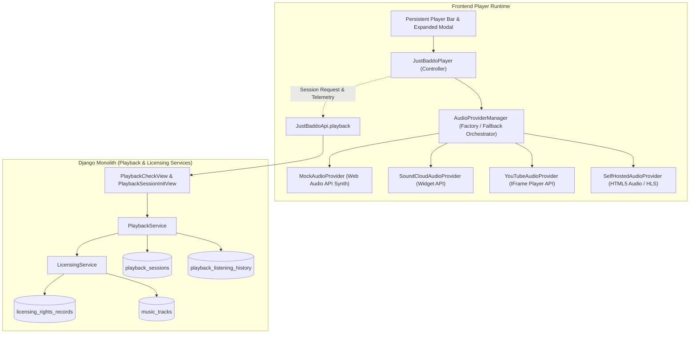
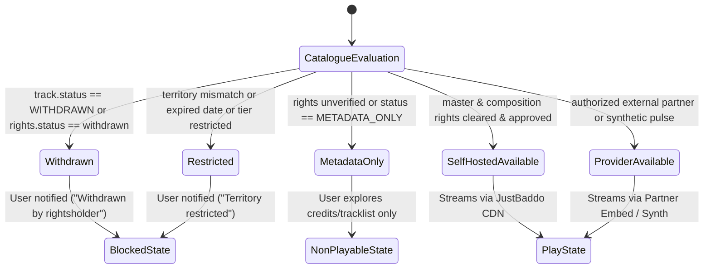
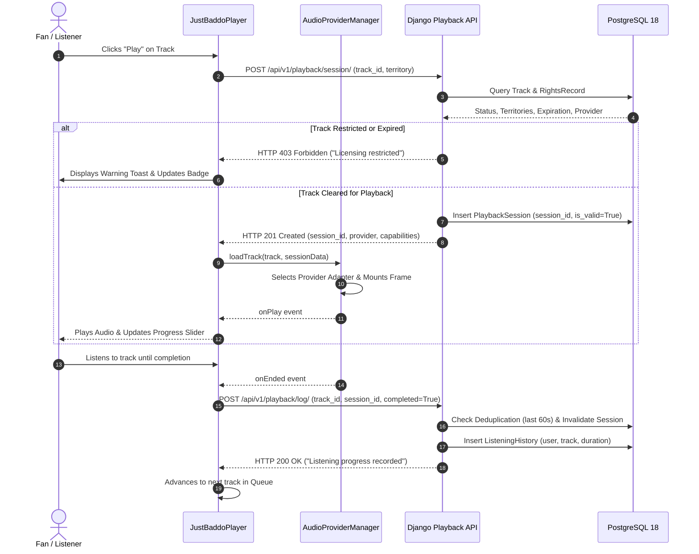

# JUSTBADDO — PROVIDER-INDEPENDENT PLAYBACK ARCHITECTURE

## 1. Architectural Philosophy

The JustBaddo playback architecture decouples **music discovery and user experience** from **audio stream delivery**. 

The core music player never binds to a proprietary streaming SDK directly. Instead, a clean provider interface layer abstracts playback primitives, allowing the platform to dynamically route tracks to authorized external embeds (SoundCloud, YouTube), synthetic preview generators (Web Audio API), or future direct licensed CDN streams (HLS/DASH) without altering any user interface components.

---

## 2. End-to-End System Architecture

---

## 3. Playback Availability State Machine

Every track in the catalogue is evaluated against 5 discrete availability states. Server-side validation guarantees that a client cannot trigger playback on an ineligible recording:

### State Specifications

| State | Definition | Server Session Issued? | Frontend UI Player Behavior |
|---|---|---|---|
| `metadata_only` | Track metadata is catalogued, but audio rights are not cleared for web streaming. | **No (HTTP 403 / can_play: false)** | Gray badge `METADATA ONLY`. Track can be inspected for credits, lyrics, and BPM, but play button is disabled. |
| `provider_available` | Audio is cleared for streaming via an authorized third-party partner embed (SoundCloud/YouTube) or synthetic pulse. | **Yes (HTTP 201 Created)** | Amber badge `AUTHORISED PROVIDER`. Audio plays seamlessly through active adapter. |
| `self_hosted_available` | Direct master and mechanical streaming rights cleared and approved by rightsholders. | **Yes (HTTP 201 Created)** | Emerald badge `DIRECT LICENSED`. High-fidelity audio delivered via HTML5 Audio / HLS pipeline. |
| `restricted` | Track playback is prohibited in client's geographic territory, licensing period expired, or tier restricted. | **No (HTTP 403 / can_play: false)** | Rose badge `RESTRICTED`. Toast warning displayed: *"Recording not licensed in your territory."* |
| `withdrawn` | Track has been formally pulled from digital streaming by rightsholders or legal representatives. | **No (HTTP 403 / can_play: false)** | Red badge `WITHDRAWN`. Play button locked; explanatory notice displayed. |

---

## 4. Playback Session & Telemetry Lifecycle

---

## 5. Graceful Provider Fallback Hierarchy

To ensure the listener's session is never terminated by external network failures or browser extensions:
1. `AudioProviderManager` initializes the requested external provider (`SoundCloud` or `YouTube`).
2. If the provider iframe triggers `onError` (or fails to load within 2.5 seconds), the manager automatically catches the exception.
3. The manager logs the error and dynamically falls back to `MockAudioProvider` (Web Audio API synth).
4. The user receives a gentle notification toast: *"Partner stream unavailable. Switched to synthetic demonstration audio."*
5. The queue continues advancing without freezing the UI player bar.
