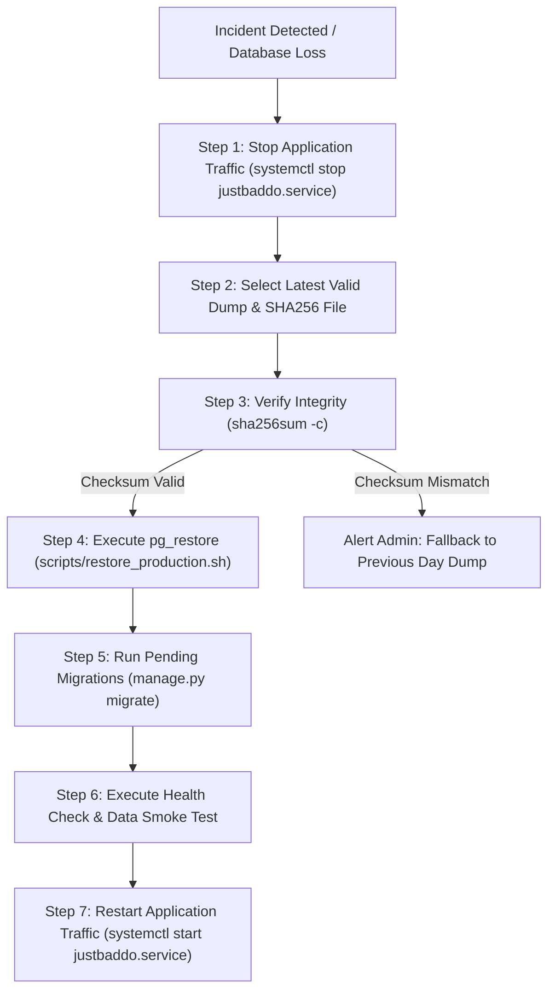

# JUSTBADDO — BACKUP AND DISASTER RECOVERY SPECIFICATION

## 1. Overview and Recovery Objectives

The JustBaddo database stores critical records: discography metadata, track availability, user accounts, custom playlists, fan community discussions, poll votes, and listening telemetry history.

To guarantee business continuity and guard against hardware failure, data corruption, or operator error, this document outlines the automated backup strategy, verification processes, and step-by-step disaster recovery procedures.

### Operational Objectives

| Metric | Target | Rationale |
|---|---|---|
| **Recovery Point Objective (RPO)** | **< 24 Hours** (Launch) / **< 15 Mins** (Scale) | Daily automated snapshots ensure maximum data loss window is less than 24 hours. Future WAL archiving reduces this to minutes. |
| **Recovery Time Objective (RTO)** | **< 15 Minutes** | A complete database restore from a verified custom dump can be completed within 15 minutes. |
| **Backup Integrity Rate** | **100% Verified** | Every backup file is accompanied by a SHA256 checksum and routinely verified against an isolated test database. |

---

## 2. Backup Strategy and Implementation

### 1. Logical Snapshots (`pg_dump -Fc`)
- We utilize PostgreSQL's custom archive format (`-Fc`).
- **Advantages:**
  - Highly compressed (typically 70–80% smaller than plain SQL text).
  - Supports selective table restoration and parallel worker restoration via `pg_restore -j <cores>`.
  - Preserves BLOBs, schema definitions, indices, and database constraints.

### 2. Automated Daily Snapshot Script (`scripts/backup_production.sh`)
The script executes automatically via a system cron job or Docker container schedule:

```bash
#!/usr/bin/env bash
# Sample invocation via crontab:
# 0 2 * * * /var/www/justbaddo/scripts/backup_production.sh >> /var/log/justbaddo_backup.log 2>&1
```

**Actions Performed by the Script:**
1. Connects to the PostgreSQL instance via secure socket or password credentials.
2. Generates a timestamped dump: `/backups/justbaddo_db_YYYYMMDD_HHMMSS.dump`.
3. Computes SHA256 checksum: `/backups/justbaddo_db_YYYYMMDD_HHMMSS.dump.sha256`.
4. Enforces the **14-day retention policy**, automatically purging dumps older than 14 days to prevent storage exhaustion.

### 3. Off-Site Backup Synchronization
To protect against complete host or datacenter loss, backups are replicated to an external, encrypted object storage bucket (e.g. AWS S3 or Cloudflare R2):

```bash
# Example synchronization command via AWS CLI / rclone:
aws s3 sync /backups s3://justbaddo-backups-secure/daily/ --storage-class STANDARD_IA
```

---

## 3. Disaster Recovery and Restoration Procedure

### Recovery Workflow Diagram



### Step-by-Step Recovery Execution

1. **Halt Application Traffic:**
   Prevent writes during recovery:
   ```bash
   sudo systemctl stop justbaddo.service
   ```

2. **Locate and Verify the Target Backup:**
   ```bash
   ls -lt /backups/justbaddo_db_*.dump | head -n 1
   ```
   Verify checksum integrity:
   ```bash
   sha256sum -c /backups/justbaddo_db_20261118_020000.dump.sha256
   ```

3. **Execute Restoration Script:**
   Use the verified recovery utility:
   ```bash
   ./scripts/restore_production.sh /backups/justbaddo_db_20261118_020000.dump justbaddo_db
   ```
   *The script drops existing tables using `--clean --if-exists`, restores schema, indices, sequences, and tables cleanly, and reports elapsed time.*

4. **Verify Database Consistency:**
   Run an operational smoke test via Django management:
   ```bash
   python manage.py showmigrations
   python manage.py check
   ```

5. **Resume Application Services:**
   ```bash
   sudo systemctl start justbaddo.service
   curl -s http://127.0.0.1:8000/api/v1/health/ | grep '"status":"healthy"'
   ```

---

## 4. Routine Restoration Drill Policy

A backup is only as good as its tested recovery. The engineering team must conduct a **monthly recovery drill**:
1. Restore the latest production backup into a disposable test database (`justbaddo_db_drill`).
2. Run automated tests against it:
   ```bash
   POSTGRES_DB=justbaddo_db_drill python manage.py test
   ```
3. Record drill completion timestamp and log in [`docs/deployment/LAUNCH_CHECKLIST.md`](file:///c:/Users/USER/Documents/JustBaddo/docs/deployment/LAUNCH_CHECKLIST.md).
