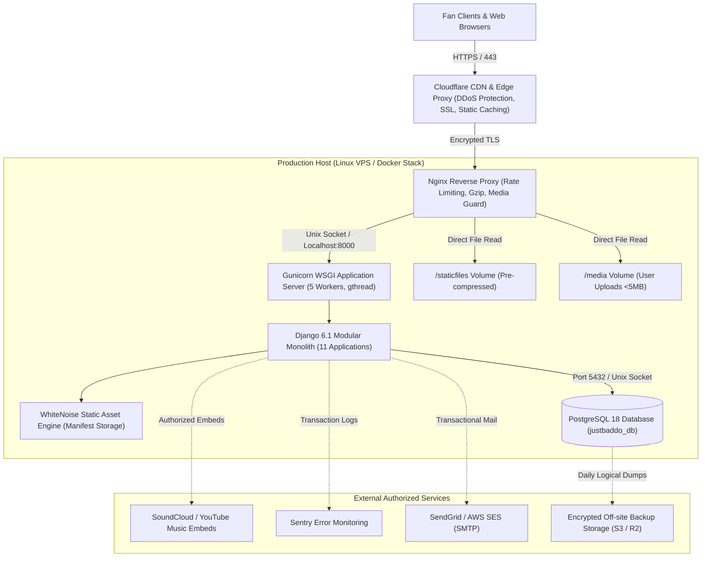

# JUSTBADDO — PRODUCTION ARCHITECTURE SPECIFICATION

## 1. Hosting Architecture Evaluation

To select the most practical, reliable, and cost-effective hosting architecture for JustBaddo, we evaluated three primary hosting paradigms against our requirements: a Django 6.1 modular monolith, PostgreSQL 18 relational database, 23 server-rendered HTML5 pages, dynamic REST APIs, and future audio delivery.

### Option Comparison Matrix

| Criteria | Bare/Cloud VPS (DigitalOcean / Hetzner / AWS EC2) | Platform as a Service (Render / Railway / Fly.io) | Serverless (AWS Lambda / Zappa / Vercel) |
|---|---|---|---|
| **Architectural Fit** | **Optimal** — Full control over PostgreSQL 18, Nginx reverse proxy, and system sockets. | **Moderate** — Easy deploy, but higher database pricing and less reverse-proxy control. | **Poor** — High cold start latency, poor fit for long-running streaming/audio sessions. |
| **Monthly Cost (MVP)** | **$10 – $28 / month** | $35 – $70 / month | $15 – $50 / month (variable with invocations) |
| **Operational Simplicity** | Standard Linux system administration or Docker Compose. | Git-push deployments with automated build packs. | Complex packaging and cloud provider lock-in. |
| **Static & Media Delivery** | Native Nginx caching + WhiteNoise + Cloudflare CDN. | Provider static storage add-ons. | S3 + CloudFront required from day one. |
| **Database Tuning** | Full PostgreSQL configuration control (`pg_dump`, WAL, extensions). | Managed PostgreSQL with limited superuser controls. | Serverless database (Neon/Aurora) with connection poolers. |
| **Verdict** | **RECOMMENDED (Primary)** | Viable alternative for quick prototype testing. | **NOT RECOMMENDED** for this monolithic architecture. |

---

## 2. Recommended Hosting Architecture

### Tier 1: Launch & Community Validation (0 – 25,000 MAU)

For initial public launch and early growth, JustBaddo will operate on a single hardened Linux VPS or containerized Docker host fronted by Cloudflare:

### Component Breakdown

1. **Edge & CDN Layer (Cloudflare Free Tier):**
   - Universal SSL/TLS certificate termination.
   - Global Anycast CDN caching all static assets (`.css`, `.js`, `.svg`, `.webp`).
   - Web Application Firewall (WAF) rule sets protecting against automated bots, credential stuffing, and volumetric layer 7 DDoS attacks.

2. **Reverse Proxy Layer (Nginx 1.27):**
   - Terminates TLS from Cloudflare using Origin CA certificates or Let's Encrypt.
   - Serves pre-compressed static assets directly from disk with immutable cache headers (`max-age=31536000`).
   - Enforces IP-based rate limiting on sensitive endpoints:
     - `/api/v1/accounts/login/`: 5 requests per minute.
     - `/api/`: 20 requests per second.
   - Enforces strict request body limits (`client_max_body_size 5M`) to prevent disk exhaustion attacks.

3. **Application Server Layer (Gunicorn 23.0.0):**
   - WSGI runner configured with `gthread` worker model: 5 workers, 4 threads per worker = 20 concurrent execution threads.
   - Automatic worker recycling after requests to prevent memory leaks.
   - Communication over high-performance Unix socket or isolated internal Docker bridge network (`justbaddo_internal`).

4. **Relational Database Layer (PostgreSQL 18):**
   - Dedicated database cluster with persistent volume.
   - Tuned memory parameters: `shared_buffers = 1GB`, `work_mem = 16MB`, `maintenance_work_mem = 256MB`.
   - Connection reuse enabled via Django `CONN_MAX_AGE = 600`.
   - Automated daily logical backups (`pg_dump -Fc`) with SHA256 integrity checksums.

5. **Static & Media Asset Handling:**
   - **Static Files:** Processed via `python manage.py collectstatic`. WhiteNoise provides content-hashed file names (`styles.a8f9c1e2.css`) for zero-cache-invalidation deployment.
   - **Media Assets:** User profile pictures and story attachments stored in `/media/`. Strict upload validation blocks executables, non-image formats, and files larger than 5MB.

---

## 3. Music & Audio Delivery Architecture

### Legal & Technical Boundary

In accordance with [`docs/music/JUSTBADDO_MUSIC_LICENSING.md`](file:///c:/Users/USER/Documents/JustBaddo/docs/music/JUSTBADDO_MUSIC_LICENSING.md):

1. **Zero Raw Audio Hosting:**
   - The production server **does not** store or stream MP3, AAC, FLAC, or WAV files of copyrighted recordings.
   - Attempting to bypass this via raw file hosting would expose the project to copyright liability and DMCA takedowns.

2. **Audio Provider Abstraction:**
   - All audio playback interactions are channeled through the `AudioProviderInterface`.
   - In production development/preview mode, the platform defaults to the verified Web Audio API synthetic harmonic pulse generator.
   - For public music playback, the platform connects to authorized third-party provider embeds:
     - **SoundCloud API / Widget:** Streams tracks authorized by rightsholders via official iframe/widget protocols.
     - **YouTube Embedded Player:** Embeds official YBNL / EMPIRE / Olamide music videos and audio visualizers.
     - **Future Direct CDN (Phase 7):** When mechanical and master streaming licenses are executed, audio files will be served from an encrypted S3/Cloudflare R2 bucket via signed URLs with HLS chunking.

---

## 4. Expected Infrastructure Cost Analysis

### Baseline Budget (Launch Phase)

| Service | Provider | Specifications | Estimated Cost |
|---|---|---|---|
| **Application & Database Host** | Hetzner Cloud (CPX21) *or* DigitalOcean Droplet | 3 vCPU, 4GB RAM, 80GB NVMe SSD, 20TB traffic | **$9.00 – $24.00 / mo** |
| **DNS, CDN & DDoS Mitigation** | Cloudflare | Free Tier (unlimited bandwidth, global edge CDN) | **$0.00 / mo** |
| **SSL/TLS Certificates** | Let's Encrypt / Cloudflare Origin CA | Automated 90-day renewal via Certbot | **$0.00 / mo** |
| **Off-site Backup Storage** | Cloudflare R2 / AWS S3 | Up to 10GB compressed database dumps | **$0.15 – $0.50 / mo** |
| **Transactional Email** | SendGrid / AWS SES | Up to 3,000 emails/mo (account verification, password reset) | **$0.00 – $1.00 / mo** |
| **Domain Registration** | Porkbun / Namecheap | `justbaddo.com` (.com TLD) | **~$10.00 – $14.00 / year** ($1.00/mo) |
| **Total Monthly Operating Cost** | | | **~$11.00 – $26.50 / month** |

### Growth Scaling Budget (25,000 – 100,000 MAU)

| Service | Provider | Specifications | Estimated Cost |
|---|---|---|---|
| **App Server (Web Tier)** | DigitalOcean Droplet / Hetzner | 4 vCPU, 8GB RAM | $35.00 – $48.00 / mo |
| **Managed PostgreSQL Database** | DigitalOcean Managed DB / AWS RDS | 2 vCPU, 4GB RAM, Automated Backups, High Availability standby | $45.00 – $65.00 / mo |
| **Redis Cache Cluster** | Managed Redis / Container | 1GB RAM (throttling & session caching) | $15.00 / mo |
| **Object Storage (Media & CDN)** | Cloudflare R2 + CloudFront | 50GB storage + bandwidth | $5.00 – $10.00 / mo |
| **Total Scaled Operating Cost** | | | **~$100.00 – $138.00 / month** |
